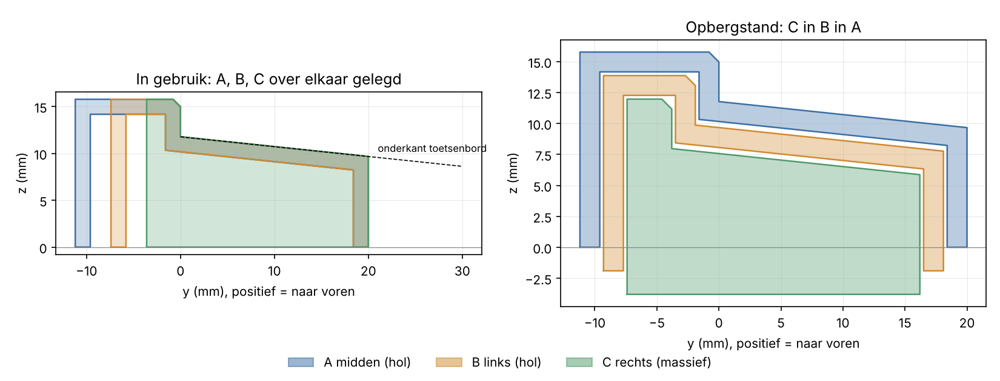

<!--
SPDX-FileCopyrightText: 2026 Joost Meyfroodt
SPDX-License-Identifier: GPL-3.0-or-later
-->

# XK01-verhoging (Fusion-script)

Driedelige verhoging voor het ProtoArc XK01. In gebruik liggen de drie delen op een lijn onder de achterrand van het toetsenbord en klikken ze met magneten aan elkaar. Voor transport schuift C in B en B in A, zodat je een pakketje van ongeveer 137 x 31 x 20 mm overhoudt.



## Hoe het werkt

- **Zelfde zitting voor alle drie.** Zitting, aanslagvlak en helling liggen bij A, B en C op exact dezelfde plaats. Het toetsenbord ligt dus recht, ook al zijn de delen verschillend van maat.
- **Nesten van onderen.** A en B zijn holle profielen die onderaan open zijn. B schuift van onderen in A, C in B. Elk deel is per niveau 2 x (wand + speling) kleiner in diepte en 2 x (eindplaat + speling) korter. In opbergstand steekt elk binnendeel 1,9 mm onder het vorige uit, vandaar de 20 mm pakkethoogte.
- **Wat het verschil in maat zichtbaar maakt:** alleen de achterkant van de lip. A steekt achteraan 11,2 mm uit, B 7,4 mm, C 3,6 mm. Dat zit achter het toetsenbord.
- **Vasthouden.** De achterrand van het toetsenbord valt tegen een lip van 4 mm met een kleine afschuining. Grip komt van een strook antislip op de zitting en rubber onder de eindplaten. Een opstaande voorrand of een haak over de bovenrand kan niet: zie verderop.

Volgorde in gebruik: **B links, A midden, C rechts.** A is het enige deel met magneten aan beide kanten.

## Gebruik in Fusion

1. Kopieer de map `xk01_riser` naar je pc.
2. Fusion: *Utilities > Add-Ins > Scripts and Add-Ins*, tab *Scripts*, het plusteken, en kies de map.
3. Pas zo nodig de maten bovenaan `xk01_riser.py` aan (Fusion opent de editor via *Edit*).
4. *Run*. Het script opent een nieuw document met drie componenten.
5. Zet `LAYOUT = "genest"`, draai opnieuw en doe *Inspect > Interference* op de drie componenten. Er mag niets botsen.
6. Exporteer per component: rechtsklik op de body, *Save As Mesh* (3MF of STL).

De maten zijn geen Fusion-gebruikersparameters. Bewust: de nestmaten volgen uit elkaar en een fout in een van die afhankelijkheden zie je in Fusion pas bij het printen. Wijzig in het script en draai opnieuw.

Het model is Z-boven. Staat Fusion bij jou op Y-boven, dan ligt het geheel op zijn rug in de viewport. Voor de export maakt dat niets uit.

## Wat je eerst moet nameten

| Parameter | Standaard | Wat |
|---|---|---|
| `KB_WIDTH` | 386,4 | Uitgevouwen breedte. Bronnen spreken van 386,3 tot 386,4 mm. |
| `KB_SPAN` | 112 | Afstand van het voorste rubberpad tot de achterrand. Geschat, niet gemeten. |
| `TILT_DEG` | 6 | Gewenste helling. Geeft een zittinghoogte van 11,8 mm aan de aanslag. |
| `HINGE_NOTCHES` | leeg | Alleen invullen als de scharnierbumpers achteraan uitsteken. Hou de diepte op maximaal 1 mm, anders snij je door de wand van 1,6 mm. |

`KB_SPAN` en `TILT_DEG` bepalen samen de hoogte. Vijf graden geeft 9,8 mm, zeven graden 13,8 mm.

## Controle buiten Fusion

```sh
pip install shapely matplotlib
python3 check_geometry.py doorsnede.png
```

Controleert dat elk binnendeel met minstens `CLEARANCE` speling in het buitendeel past, dat de wanden overal minstens `WALL` dik zijn, dat de magneetgaten met minstens 1 mm vlees in alle drie de profielen vallen, en dat de lengtes kloppen. Draai dit na elke maatwijziging.

## Printen

- **Materiaal:** PETG. PLA kan, maar wordt in een auto of op een vensterbank zacht.
- **A en B rechtop**, op een kopse kant. Dan zit het hele profiel in het XY-vlak van de printer: geen overhang, en de nestspeling zit in de nauwkeurigste richting. Gebruik een brim van 5 tot 8 mm, de onderdelen zijn 137 en 128 mm hoog op een smal voetje. De bovenste eindplaat overbrugt de holte (circa 26 mm), dat lukt met PETG zonder support.
- **C plat** op de onderkant.
- Zet *elephant foot compensation* aan (0,15 tot 0,2 mm). Een uitgezette eerste laag aan de kopse kant eet de 0,3 mm speling op.
- Minstens 4 perimeters, zodat de wanden van 1,6 mm volledig massief zijn.

## Magneten

Ø6 x 3 mm neodymium, 8 stuks: 2 per koppelvlak, op de linker- en rechterkant van A, de rechterkant van B en de linkerkant van C. De gaten zijn open en 3,2 mm diep: magneet erin met een druppel secondelijm. Pauzeren op hoogte werkt hier niet, de as van de gaten ligt horizontaal.

Polariteit, de enige regel: **elke magneet met dezelfde pool naar rechts.**

1. Leg alle magneten als een staafje op elkaar en zet een stip op de bovenkant van elke magneet.
2. Rechterkant van A en rechterkant van B: stip naar buiten.
3. Linkerkant van A en linkerkant van C: stip naar binnen, in het gat.

Zo trekken A en B, en A en C elkaar aan. In opbergstand trekken de magneten van de binnendelen ook naar die van A, wat het pakketje bij elkaar houdt.

## Antislip

- Een strook siliconen of EVA-tape van circa 1 mm op de zitting van elk deel. Neem overal dezelfde dikte, anders ligt het toetsenbord scheef. Tape op de zitting hindert het nesten niet: het binnendeel zakt gewoon iets minder ver in.
- Rubber voetjes (zoals 3M Bumpon) onder de eindplaten van A en B en onder C. Ook hier: overal even dik.

## Grenzen van dit ontwerp

- **Geen opstaande voorrand en geen haak.** De onderkant van het toetsenbord is een vlak dat over de zitting heen naar voren loopt. Alles wat boven dat vlak uitsteekt, drukt het toetsenbord omhoog. Een voorrand werkt alleen met een gleuf waar de rubberpads in vallen, en die botst bij het nesten met het deel erboven. Een haak over de bovenrand nest om dezelfde reden niet.
- **Geen zijwandjes aan de uiteinden.** Die moeten buiten de toetsenbordbreedte vallen en steken bij het nesten tegen het plafond van het buitendeel.
- **Geen paspennen.** Elk deel staat over de volle lengte op tafel, dus er is geen doorbuiging om op te vangen. Z volgt uit de tafel, Y uit de achterrand van het toetsenbord tegen de lip, X uit de magneten.
- **Het script is niet in Fusion gedraaid** bij het schrijven. De profielmaten zijn met `check_geometry.py` gecontroleerd, de Fusion-API-aanroepen niet. Een fout in die laag geeft een melding met traceback in Fusion.

## Bronnen voor de maten

- Uitgevouwen 386,4 x 119,7 x 12,4 mm, ingeklapt 215,5 x 119,7 x 20,9 mm, middenpaneel 215,5 mm: [The Gadgeteer, review XK01](https://the-gadgeteer.com/2025/04/08/protoarc-xk01-folding-keyboard-review-an-edc-keyboard-that-does-origami/). Micro Center vermeldt 386,33 x 119,63 x 12,19 mm.
- De twee buitenpanelen klappen op het middenpaneel. Als de panelen symmetrisch zijn, zitten de scharnieren op circa 85,5 mm van elke rand. Niet nagemeten.
